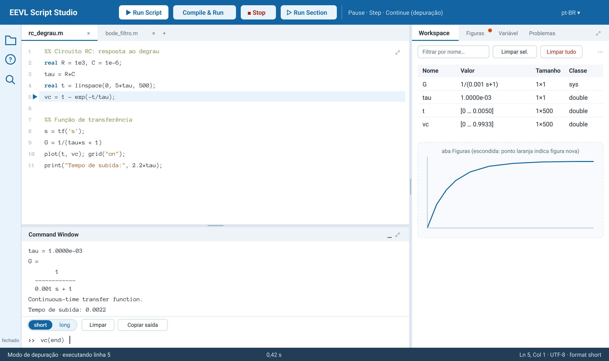
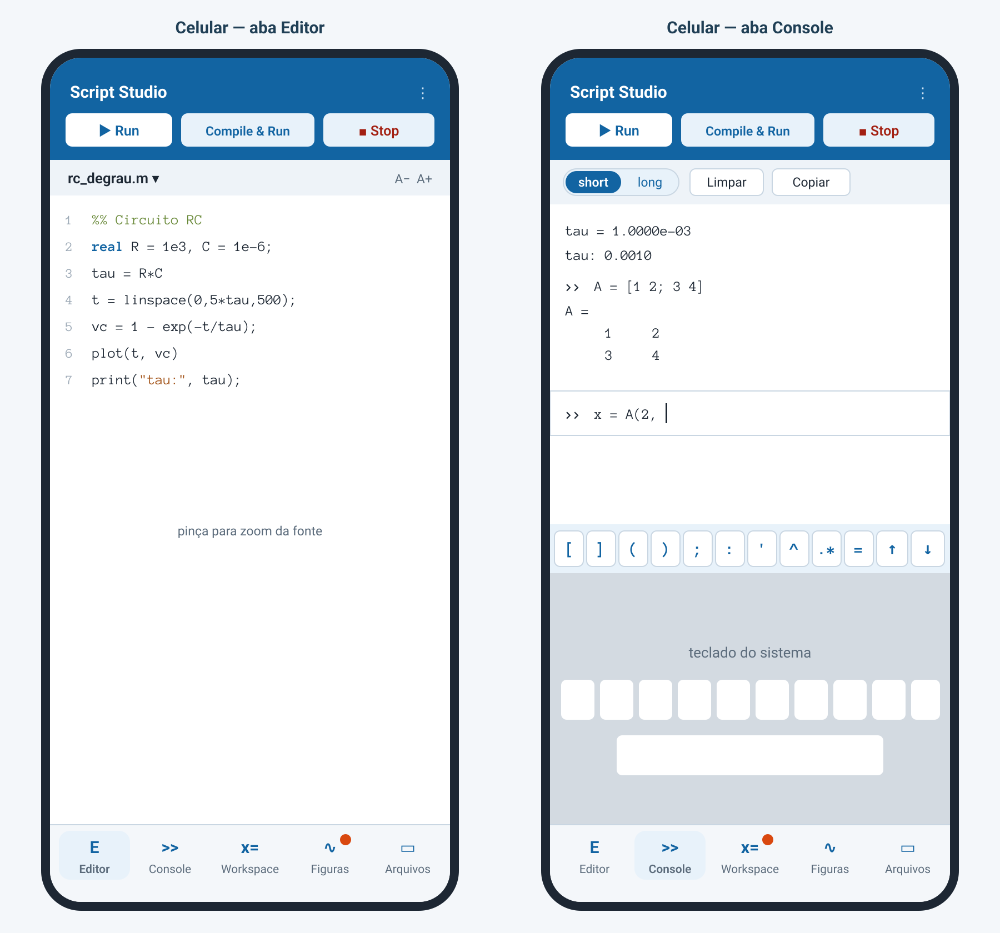

# EEVL Script Studio — Proposta de execução, segurança e contrato semântico

**Estado: proposta aprovada parcialmente (28/11/2026).** Nada aqui está implementado, exceto o parser e o formatador da fase 1 (em desenvolvimento, gramática em [SCRIPT-GRAMMAR.md](SCRIPT-GRAMMAR.md)), as funções do core da seção 7.1 já documentadas em [API.md](API.md) e a prova de conceito da fase 0 (`experiments/script-studio-poc/`). Decisões tomadas e questões em aberto estão na seção 12. Versão viva: documento no Claude Docs; esta cópia é a referência para agentes.

## 1. Resumo das decisões propostas

Esta proposta resolve os problemas identificados na revisão da especificação conceitual e registra as decisões de linguagem tomadas depois. Ela não substitui a especificação: indica o que muda e o que ainda falta decidir (seção 12).

**Terminologia usada em todo o documento:**

- **Modo de depuração** (botão *Run Script*): executa instrução por instrução, com exibição implícita, linha atual e depuração.
- **Modo rápido** (botão *Compile & Run*, nome a confirmar): executa o script inteiro como uma única função JavaScript, sem visualizações implícitas.
- **Tradutor**: o componente único (parser → AST → gerador de JavaScript) que atende aos dois modos. Não há interpretador de AST separado.
- **Runtime**: as rotinas JavaScript do Script Studio (valores, operadores, indexação, variantes de funções) usadas pelo código gerado.
- **Core**: a biblioteca matemática existente em `assets/js/core/`.

1. **Princípios como requisitos** (seção 1.1): resultados idênticos nos dois modos, tipos conhecidos antes da execução, padrões pelo uso mais comum, exceções explícitas, declarações opcionais, erro em vez de resultado silencioso, compatibilidade com MATLAB como preferência, sem ambiguidade sintática.
2. **Um tradutor, duas configurações** (seção 5): o mesmo tradutor gera, no modo de depuração, um gerador JavaScript (`function*`) com ponto de pausa por instrução e, no modo rápido, uma única função JavaScript sem instrumentação. Os pontos de pausa permitem breakpoints e passo a passo sem `SharedArrayBuffer`.
3. **Execução segura do código gerado** (seção 3): JavaScript gerado só a partir da AST, executado num Worker e carregado via Blob URL, sob uma CSP em `<meta>`. A segurança vem da geração controlada, não da proibição literal de `eval`. Se o ambiente bloquear isso, os dois modos passam a usar *closure compilation*.
4. **Cancelamento** (seção 4): Stop = `worker.terminate()`, nos dois modos, com watchdog na thread principal.
5. **Tipos previsíveis** (seção 6.1): declarações opcionais `int`, `real`, `complex`, `bool`, `char` e `sys`; tamanho fixo nas variáveis declaradas, com `varsize` como exceção; real por padrão, com `complexsqrt`, `complexlog`, `complexpower` para resultados complexos.
6. **Desempenho** (seções 6 a 6.3): análise de tipos no modo rápido, variantes de cada função por tipo, escrita sem cópia e otimizações que não alteram o resultado.
7. **Representação e core** (seções 7 a 7.2): tipo de valor próprio (`Float64Array` column-major), adaptadores para o core, levantamento do que falta no core e tipo embutido `sys` com registro de tipos.
8. **Contrato semântico e testes** (seções 8 a 10): decisões de linguagem verificadas por testes diferenciais e referências geradas no Octave.
9. **Ordem de implementação** (seção 11): prova de conceito de execução segura primeiro, depois corte vertical. As funções novas do core podem ser feitas em paralelo desde já.

### 1.1 Princípios da linguagem (requisitos)

A linguagem do Script Studio parte do MATLAB/Octave, mas faz modificações deliberadas para que o script possa ser traduzido corretamente para JavaScript e executado com o desempenho que o JIT do navegador oferece. Toda decisão de linguagem deve respeitar os requisitos abaixo. Quando dois deles conflitarem, vale a ordem da lista.

1. **Resultados idênticos nos dois modos.** O modo de depuração e o modo rápido produzem os mesmos valores, bit a bit. As diferenças permitidas são só de exibição, depuração, velocidade e do momento em que um erro aparece (a mensagem e a linha são as mesmas).
2. **Tipos conhecidos antes da execução.** O tipo de cada variável e de cada expressão (classe, real ou complexo, forma) deve poder ser determinado antes de executar, a partir do código, das declarações e do Function Registry. O tipo do resultado de uma função depende do tipo dos argumentos, nunca do seu valor.
3. **Padrões escolhidos pelo uso mais comum.** O comportamento padrão reflete o que é mais usado no dia a dia de engenharia elétrica: números reais, `double`, matrizes 2-D, variáveis declaradas com tamanho fixo. Quem segue o caso comum não escreve nada a mais.
4. **A exceção é explícita.** O caso menos comum é pedido pelo nome: `complexsqrt`, `complexlog`, `complexpower`, `varsize`, a declaração `complex`. Nunca o contrário.
5. **Declarações são opcionais.** Um script sem declarações funciona. Declarar acrescenta verificação e desempenho, não é condição para executar.
6. **Erro em vez de resultado silencioso.** Quando uma operação não pode produzir o tipo esperado, o resultado é um erro com a linha e a correção sugerida, não um `NaN` nem uma mudança de tipo escondida.
7. **Compatibilidade com MATLAB é preferência, não obrigação.** A sintaxe e as convenções do MATLAB/Octave são mantidas sempre que não contrariam os requisitos anteriores. Cada divergência fica documentada, com a mensagem de erro indicando a forma correta.
8. **Sem ambiguidade sintática.** Cada trecho de código tem uma única leitura possível. Por isso não há sintaxe de comando (`hold on`), e as palavras-chave de declaração só valem no início da instrução.

**Padrões atuais** (requisito 3):

| Aspecto | Padrão | Exceção explícita |
| --- | --- | --- |
| Número | `double` real | `complex`, literal `1i`, funções `complex*` |
| Funções elementares | real → real | `complexsqrt`, `complexlog`, `complexpower`... |
| Funções espectrais (`roots`, `eig`, `pole`, `zero`) | complexo | `real(...)` |
| Tamanho de variável declarada | fixo na inicialização | `varsize`, inicialização com `[]` |
| Variável não declarada | tipo inferido, tamanho livre, como no MATLAB | declaração |
| Dimensões | 2-D | (N-D fora da v1) |
| Texto | `char`, com `'...'` ou `"..."` | (tipo `string` fora da v1) |
| Erro de domínio | erro com sugestão | — |

Novos padrões devem ser decididos pelo mesmo critério: o que os scripts de aula e de projeto usam com mais frequência.

## 2. Estado atual do núcleo matemático

Verificação rápida de `assets/js/core/` (21 módulos, cerca de 5.600 linhas) e de `docs/API.md`:

- Módulos ESM puros, sem DOM e sem dependências. Podem ser importados diretamente no Worker.
- Matrizes reais são **arrays de linhas** (`A[linha][coluna]`), **base 0**. Vetores são matrizes coluna n×1; `[]` é a matriz 0×0.
- Complexos escalares ficam em `complex.js`; raízes e pontos `s` são pares `[re, im]`; a álgebra complexa fica num módulo separado (`cmatrix.js`).
- Polinômios em ordem decrescente (igual ao MATLAB), frequência em rad/s, fase em graus.
- Entradas inválidas lançam `TypeError`/`RangeError`; `msolve`/`inv` lançam erro com `code = 'SINGULAR_MATRIX'`.
- As funções portadas do SISO são comparadas por igualdade exata com o original, então sua aritmética não pode mudar.

**Consequências:**

- A convenção do core difere da que o Studio precisa (column-major, base 1, real e complexo unificados). A camada de adaptação é inevitável e é o maior custo oculto do projeto (seção 7).
- O core não deve ser alterado para servir o Studio. O Studio se adapta, e o core mantém seus contratos e testes.
- Os erros do core já têm tipos distintos, então o runtime pode convertê-los em mensagens no estilo MATLAB, com a linha do script.
- O levantamento do que falta no core, e do que pertence ao runtime do Studio, está na seção 7.1.

## 3. Execução segura do código gerado

**Natureza da execução.** Nenhum dos modos é compilação no sentido clássico. Os dois traduzem o script para JavaScript e deixam o motor do navegador executar e otimizar esse código com o JIT que ele já tem. O EEVL não gera código de máquina. O termo "compilar" fica só no nome do botão, se for mantido (questão em aberto), e a documentação técnica fala em tradução.

**Problema.** A seção 13 da especificação proíbe `eval()` e `new Function()`, mas os dois modos precisam executar JavaScript gerado em tempo de execução. Todo mecanismo para isso (`new Function`, `eval`, `import()` de Blob URL, `importScripts`) é execução de código dinâmico. Lida literalmente, a regra tornaria o Script Studio impossível.

**Proposta.** Trocar a regra "não usar eval" por "executar só o JavaScript que o tradutor emitiu, num ambiente sem capacidades":

1. **Geração controlada.** O tradutor é a única fonte do texto JavaScript e nunca copia trechos do código-fonte. Identificadores viram nomes renomeados (`v_x`). Números são reemitidos a partir do valor, e strings via `JSON.stringify`. Nenhuma construção do usuário vira acesso a propriedade arbitrária, global ou `this`.
2. **Validação da saída.** Nos testes e em modo de desenvolvimento, parsear o JS emitido e verificar que ele só referencia identificadores permitidos (`v_*`, temporários `t_*`, `rt`). É uma rede contra bugs do gerador.
3. **Carregamento (corrigido pela fase 0).** A página cria o Worker de execução **a partir de um Blob mínimo** cujo conteúdo é só `import "<URL absoluta de runtime-worker.js>";`, com `new Worker(blobURL, {type: 'module'})`. Um Worker criado por Blob herda a CSP da página; um Worker carregado direto do arquivo do site **não** herda, porque recebe a política da própria resposta HTTP, e o GitHub Pages não envia CSP (verificado no Edge: `eval` permitido no Worker por URL, bloqueado no Worker por Blob). O `runtime-worker.js` importa o core por caminhos relativos, resolvidos a partir da URL dele. Ele recebe o texto gerado, cria um Blob URL de um módulo que exporta `main(rt)` e faz `import()` desse Blob.
4. **Redução de capacidades.** Antes de carregar o código gerado, o bootstrap do Worker remove ou neutraliza `fetch`, `XMLHttpRequest`, `WebSocket`, `importScripts`, `indexedDB` e `caches`, e guarda `postMessage` numa closure privada do runtime. Não é uma sandbox completa (por isso a defesa principal é a geração controlada), mas limita o impacto de um bug.
5. **CSP por `<meta>`** na página do Studio, já que o GitHub Pages não permite cabeçalhos: `default-src 'self'; script-src 'self' blob:; worker-src 'self' blob:; connect-src 'self'; object-src 'none'; base-uri 'none'`. Sem `'unsafe-eval'`. **Resultado da fase 0 no Edge 158:** todos os testes passaram com essa CSP e o Worker por Blob (carregamento do core, código gerado, `eval` bloqueado, capacidades neutralizadas, pausa e passo a passo, Stop, verificação de laço infinito); detalhes em `experiments/script-studio-poc/RESULTADOS.md`. Faltam Firefox e Safari.
6. **Fallback por *closure compilation*.** Se Blob URLs forem bloqueados (política corporativa, extensão), os dois modos passam a compilar a AST para uma árvore de closures JavaScript escritas à mão. Não gera texto e não exige CSP especial. É mais lento que o JavaScript gerado, mas bem mais rápido que interpretar a AST. A semântica de cada modo (exibição, depuração) não muda. Uma alternativa intermediária é permitir `new Function` só na página do Studio, mantendo a geração controlada como defesa principal.

**Texto proposto para substituir a seção 13:**

> O código do usuário nunca é executado como texto. Os dois modos executam somente JavaScript emitido pelo tradutor a partir de AST validada, com identificadores renomeados e sem acesso a objetos globais, num Web Worker que carrega o código gerado por Blob URL, sob uma CSP sem `unsafe-eval`. Web Workers não são considerados sandbox; a defesa principal é a geração controlada de código.

## 4. Worker, cancelamento, watchdog e limites

- **Ciclo de vida.** O modo rápido usa um Worker novo por execução, que pode ser pré-aquecido. O modo de depuração usa um Worker de sessão, que mantém o workspace entre execuções (seção 5). Stop = `worker.terminate()`, que sempre funciona. O que já foi enviado à UI permanece; o resto se perde, e isso deve ser documentado.
- **Watchdog.** Fica na thread principal: tempo máximo configurável, com padrão a decidir. O runtime manda um batimento junto com cada lote de saída. Se a execução ficar muito tempo sem batimento, a UI mostra "executando há X s" com o botão Stop; o encerramento automático só acontece ao atingir o limite.
- **Protocolo Worker → UI.** Mensagens `out` (console), `ws` (workspace), `line` (linha atual), `plot`, `error` e `done` (estatísticas), com número de sequência para garantir a ordem. O envio acontece em lotes, no máximo a cada \~50 ms ou quando o buffer passa de N itens.
- **Transferência de dados.** Valores publicados no workspace são snapshots. Matrizes grandes vão como `ArrayBuffer` transferível quando possível. Acima de um teto (por exemplo 10⁶ elementos), a UI recebe só um resumo (dimensões, mínimo, máximo, primeiros elementos), e o restante é pedido sob demanda enquanto o Worker de sessão vive.
- **Limites que dá para impor de verdade:**
  - tamanho máximo por matriz e memória estimada, com contador no runtime em `zeros`, `ones`, `rand`, concatenação e crescimento por indexação;
  - volume de console (número de linhas e bytes), truncado com aviso;
  - número de figuras.

  O navegador não deixa limitar a memória total de um Worker. Isso deve ser documentado.
- **Laços infinitos.** No modo de depuração, o condutor verifica o prazo a cada N pontos de pausa (`yield`). No modo rápido, o tradutor insere uma verificação barata só nos *back-edges* de `while` e de `for` com limites não constantes (`if (++rt.tick > 65535) rt.check(linha)`). Ela produz um erro com a linha e preserva o workspace. O `terminate()` do watchdog continua como último recurso.

## 5. Os dois modos: um tradutor, duas configurações

Não há interpretador de AST separado. O mesmo tradutor (parser → AST → gerador de JavaScript) atende aos dois modos, variando só a forma do código gerado. Como as contas são feitas pelas mesmas rotinas do runtime, o requisito de resultados idênticos fica muito mais fácil de cumprir.

|  | Modo de depuração (Run Script) | Modo rápido (Compile & Run) |
| --- | --- | --- |
| Forma do código | gerador (`function*`) com `yield` antes de cada instrução | uma função comum do script inteiro, sem instrumentação |
| Variáveis | objeto `env`, fácil de inspecionar e publicar | variáveis locais do JavaScript |
| Operações | genéricas (`rt.plus`, `rt.times`), sem análise de tipos | inferência de tipos e caminho rápido nativo |
| Exibição | implícita, seguindo o `;`, mais `print`/`disp` | só `print`/`disp` |
| Linha atual, breakpoints, passo a passo | sim | não |
| Erros de tipo | na execução, na linha em que ocorrem | detectáveis antes da execução, quando possível |

**Código gerado no modo de depuração**, para o exemplo da seção 5 da especificação:

```javascript
function* main(env, rt) {
  yield 1; env.x = 0;
  yield 3;
  for (const k of rt.range(1, 5)) {
    env.k = k;
    yield 4; env.x = rt.plus(env.x, env.k); rt.show("x", env.x);
  }
  yield 7; rt.print([env.x], ["x"]);
}
```

O mesmo script no modo rápido:

```javascript
function main(rt) {
  let x = 0;
  for (let k = 1; k <= 5; k++) x = x + k;
  rt.print([x], ["x"]);
}
```

**O condutor.** No modo de depuração, um condutor no Worker consome o gerador. A cada `yield`, ele:

- atualiza a linha atual;
- entrega a saída ao console em lotes;
- verifica Stop e Pause e o prazo máximo;
- se houver breakpoint ou pedido de passo, para de consumir e espera a próxima mensagem da interface. O gerador fica suspenso com toda a pilha preservada, sem precisar de `SharedArrayBuffer` (que o GitHub Pages não permite habilitar).

**Detalhes:**

- **Funções do usuário** também viram geradores no modo de depuração e são chamadas com `yield*`, o que permite Step Into e Step Out. Funções do core são chamadas diretamente.
- **Sem análise prévia de tipos:** o modo de depuração só precisa do parse completo do arquivo (milissegundos; erros de sintaxe aparecem antes da execução, como no MATLAB). Tipos e declarações são verificados pelo runtime durante a execução. Um erro aparece na linha em que ocorre, com os resultados anteriores já visíveis.
- **Mesmo erro, momento diferente:** no modo rápido, a análise de tipos do script inteiro é obrigatória, então erros detectáveis antes (`real x` recebendo `2i`) aparecem antes de qualquer execução. A mensagem e a linha são as mesmas (requisito 1).
- **Worker de sessão:** o modo de depuração mantém o `env` entre execuções, como o workspace do MATLAB. Run Section e Run Selection traduzem só o trecho escolhido e o executam sobre o mesmo `env`. Após um Stop, o Worker é recriado e recebe de volta o último snapshot do workspace.
- **Análise no editor:** a análise de tipos roda em segundo plano no editor e mostra avisos enquanto o usuário digita, como o Code Analyzer do MATLAB, sem impedir a execução no modo de depuração.
- **Fluxo de uso esperado:** modo de depuração para desenvolver e encontrar erros; modo rápido para executar rapidamente código que já funciona.
- **Testes ainda necessários:** os dois modos compartilham o runtime, mas o caminho rápido nativo do modo rápido (`x + k` em vez de `rt.plus`) e os laços nativos são código diferente. Os testes diferenciais continuam verificando que dão o mesmo resultado.
- **Risco:** os dois modos dependem de carregar código gerado no Worker. Se a prova de conceito da fase 0 falhar, ambos passam para *closure compilation*.

**Alternativa descartada:** `coi-serviceworker` para habilitar `SharedArrayBuffer`. Acrescenta fragilidade (primeiro carregamento, recarregamento forçado) e conflitaria com o `service-worker.js` que o EEVL já tem.

## 6. Modo rápido: tipos, escalares e laços

**De onde vem o ganho.** Ter JIT não torna qualquer JavaScript rápido. O ganho aparece quando o código gerado é *estável em tipos*, ou seja, quando cada variável e cada operação lidam sempre com o mesmo tipo. Assim o motor especializa o código para números e elimina chamadas.

- **Laços e cálculos escalares:** ganho grande em relação ao modo de depuração (estimativa: uma a duas ordens de grandeza, a confirmar pelos benchmarks), *desde que* o tradutor emita `x = x + k` nativo. Se emitir `rt.plus(x, k)` genérico, que testa o tipo a cada chamada, boa parte do ganho se perde. Por isso a análise de tipos é essencial.
- **Código vetorizado** (`y = sin(2*pi*f*t)`, `A*B`, `eig(A)`): ganho pequeno na v1. Os dois modos chamam as mesmas rotinas do runtime e do core, e o tempo está dentro delas. A fusão de laços (seção 6.2), prevista para depois da v1, dá ganho também a esse caso.
- **Consequência para o runtime:** as rotinas do runtime também precisam ser amigáveis ao JIT, para beneficiar os dois modos: laços sobre `Float64Array`, sem criar objetos por elemento, e com formas de objeto fixas (todas as matrizes com as mesmas propriedades, na mesma ordem).

**Análise de tipos.** Cada variável recebe, em cada ponto do programa, um tipo com os três componentes da seção 6.1 (classe, real ou complexo, forma), mais `sys`, função e `unknown`. A análise é local a cada função na primeira versão; as funções do registro declaram as variantes e os tipos de retorno (seção 6.2). O modo de depuração não usa essa análise (seção 5).

**Emissão:**

- Se os dois operandos são real escalar, o tradutor usa o operador nativo do JavaScript (`a+b`). Caso contrário, chama a variante do runtime para os tipos conhecidos ou, se o tipo for `unknown`, o despachante genérico (`rt.plus(a,b)`). Transformações como `x^2` → `x*x` seguem a regra de exatidão da seção 6.3.
- O tipo do resultado de cada função depende só dos tipos dos argumentos (requisito 2): `sqrt` de real é real, e o resultado complexo exige `complexsqrt` ou entrada complexa (seção 6.1, "Real como padrão").
- Uma variável que pode não estar definida (atribuída só num ramo de `if`) recebe uma verificação `rt.def(...)` com a linha.

**Laço `for`, com semântica igual à do MATLAB:**

- A expressão do intervalo é avaliada uma vez.
- Para `a:s:b`, calcula-se o número de elementos antes, com tolerância de arredondamento, e `k = a + i*s` (sem acumular). Assim `0:0.1:1` tem 11 elementos.
- Intervalo vazio não executa o corpo. Passo negativo é suportado.
- Com limites inteiros escalares, o gerador emite um `for` nativo.
- Iterar sobre uma matriz percorre suas **colunas**.
- Atribuir a `k` dentro do corpo não altera as iterações seguintes.

**Variável ou função.** Regra estática, aplicada pelo tradutor nos dois modos: um identificador atribuído antes no escopo, ou que é parâmetro, é variável; os demais são procurados nas funções locais e no registro. Se nada for encontrado, o erro "função ou variável não definida" aparece na linha correspondente: no modo de depuração, quando a linha é alcançada; no modo rápido, antes da execução. O editor já avisa enquanto o usuário digita.

**Mapeamento de erros.** O gerador mantém uma tabela de posições (JS → fonte) e adiciona `//# sourceURL`. Como o formato de *stack* varia entre navegadores, a referência confiável é uma variável `rt.ln`, atualizada só antes de chamadas ao runtime e a funções, e nunca nas operações escalares do caminho rápido, onde não há erro a reportar.

**Meta de desempenho (critério de aceitação):** um laço escalar de 10⁷ iterações deve rodar pelo menos 20 vezes mais rápido no modo rápido do que no modo de depuração.

### 6.1 Inferência e declaração de tipos

O tipo de um valor tem três componentes, usados tanto na inferência quanto nas declarações:

- **classe:** `double` (com o subcaso `int`, valor sempre inteiro), `logical` (palavra-chave `bool`), `char`, `sys`, função (handle ou anônima);
- **complexidade:** real ou complexo;
- **forma:** `(1,1)` escalar, `(1,:)` vetor linha, `(:,1)` vetor coluna, `(:,:)` matriz, com dimensões conhecidas quando possível.

O tipo é obtido de cinco formas complementares, da mais automática à mais explícita.

**1. Inferência automática (padrão, sem nada escrito pelo usuário)**

- Literais: `2` é real escalar, `3i` é complexo escalar, `[1 2 3]` tem forma `(1,3)`.
- Operadores: regras por tabela (real escalar + real escalar = real escalar; `A*B` com formas `(m,n)` e `(n,p)` dá `(m,p)`).
- Funções do registro declaram tipo e forma de retorno em função dos argumentos (`zeros(n,m)` dá matriz real `(n,m)`; `size(A)` dá `(1,2)` real; `abs` dá sempre real).
- Fluxo: a variável é acompanhada através de `if`, `for` e `while`. Quando dois caminhos chegam com tipos diferentes, o tipo resultante é o mais geral (real com complexo dá complexo; escalar com matriz dá matriz; incompatível dá `unknown`).
- Variável de laço: em `for k = 1:n`, `k` é sempre real escalar inteiro.

**2. Especialização de funções do usuário por assinatura**

Cada função é traduzida uma vez para cada combinação de tipos de argumento com que é chamada, como faz o Julia. Assim `f(2)` e `f([1 2 3])` geram duas versões, e a versão escalar usa operações nativas. As versões ficam em cache, com limite de versões por função; acima dele, usa-se uma versão genérica.

**3. Caminho rápido especulativo (quando a inferência não tem certeza)**

Em vez de cair direto no runtime genérico, o gerador emite uma verificação barata:

```javascript
t = (typeof a === "number" && typeof b === "number") ? a + b : rt.plus(a, b);
```

O JIT lida bem com isso: se o ramo rápido for sempre o tomado, o custo da verificação é quase nulo. Isso reduz muito a necessidade de declarações, que ficam como reforço.

**Real como padrão**

Toda variável é presumida real. Complexo só aparece quando algo o introduz: um literal imaginário (`3i`, `1j`), a declaração `complex`, ou uma função cujo retorno pode ser complexo. Para isso, o Function Registry classifica cada função pelo tipo do retorno com entrada real:

| Classe | Exemplos | Resultado com entrada real |
| --- | --- | --- |
| Sempre real | `abs`, `angle`, `real`, `imag`, `sin`, `exp`, `zeros`, `linspace`, `norm`, `det` de matriz real | Real |
| Real para real | `sqrt`, `log`, `log10`, `log2`, `power` e `^`, `asin`, `acos`, `acosh`, `atanh` | Real; erro se o resultado exigiria complexo |
| Variante complexa | `complexsqrt`, `complexlog`, `complexpower` (alias `complexpow`), e assim por diante para cada função da linha anterior | Complexo |
| Sempre complexo | `fft`, `freqresp`, `complex`, `roots`, `eig`, `pole`, `zero` | Complexo |

**Regra:** o tipo do resultado depende só do tipo da entrada e do nome da função, nunca do valor. Entra real, sai real; entra complexo, sai complexo. Assim o tradutor conhece o tipo de toda expressão antes da execução, e o JavaScript gerado não precisa de testes de tipo por causa dessas funções.

```matlab
x = -4;
a = sqrt(x)              % erro: raiz de número negativo com argumento real; use complexsqrt(x)
b = complexsqrt(x)       % 0 + 2i
c = sqrt(complex(x))     % 0 + 2i: entrada complexa, saída complexa
d = (-8)^(1/3)           % erro: use complexpower(-8, 1/3)
e = complexpower(-8, 1/3)
```

- **Nomes:** prefixo `complex` + nome da função real, tudo junto. Para `power`, o alias `complexpow` mantém a simetria com o `realpow` do MATLAB.
- **Compatibilidade:** `realsqrt`, `reallog` e `realpow` continuam aceitos como aliases de `sqrt`, `log` e `power`, que agora já se comportam assim. Código MATLAB que conta com `sqrt(-4)` dando `2i` passa a dar erro, e a mensagem diz exatamente qual função usar.
- **Operador `^`:** com base real negativa e expoente não inteiro, dá erro e sugere `complexpower`. Com expoente inteiro (`(-2)^3`), o resultado é real normalmente.
- **Funções espectrais** (`roots`, `eig`, `pole`, `zero`): o resultado complexo é o caso normal, então retornam sempre complexo. Na exibição, valores com parte imaginária zero aparecem sem o `+0i`. Quem precisa do valor real usa `real(...)`.

**Erro ou `NaN`:** a proposta é erro, por ser um ambiente didático. O `NaN` se espalharia silenciosamente pelo resto do cálculo, sem indicar onde surgiu. Vale também para vetores: `sqrt([4 -1 9])` dá erro, indicando o primeiro elemento negativo.

**Complexo não volta a real automaticamente.** No MATLAB, um resultado complexo cuja parte imaginária zera vira real. Aqui isso violaria o requisito 2, porque o tipo passaria a depender do valor. Um valor complexo continua complexo; na exibição, parte imaginária zero aparece sem o `+0i`. Para obter o real, usa-se `real(...)`. (Consequência dos requisitos; a confirmar pelo autor, questão 4.)

**4. Declaração em funções: bloco `arguments` do MATLAB**

O MATLAB (desde a R2019b) já tem uma sintaxe de declaração para argumentos. Adotá-la mantém a familiaridade e evita inventar algo novo:

```matlab
function y = filtro(x, a, n)
    arguments
        x (1,:) double
        a (1,1) double {mustBeReal}
        n (1,1) double {mustBeInteger, mustBePositive} = 10
    end
    ...
end
```

O bloco declara forma, classe, validações e valor padrão. Dentro da função os tipos passam a ser conhecidos. A verificação acontece na entrada da função, nos dois modos, com a mesma mensagem de erro. Os validadores (`mustBeReal`, `mustBeInteger`, `mustBePositive`, `mustBeNonnegative`, `mustBeFinite`) entram no registro como funções comuns.

**5. Declaração de variáveis em scripts**

O MATLAB não tem declaração de variáveis em script. **Decidido:** palavra-chave de tipo na frente da variável, como o `persistent` do MATLAB. Asserções no estilo do MATLAB Coder (`assert(isscalar(x) && isreal(x))`) também são aceitas como dica para a análise de tipos. Foram descartados um bloco `variables ... end` e comentários-pragma (`%#type`).

**Forma:** uma instrução que começa pela palavra-chave de tipo e lista as variáveis, como `persistent a b c`:

```matlab
int n = 1000, k
real x = 0, y
complex Z
bool pronto = false;
char unidade = 'V', titulo

for k = 1:n
    x = x + 1/k^2;
end
```

**Semântica proposta:**

| Palavra-chave | Significado | No JavaScript gerado |
| --- | --- | --- |
| `int` | `double` com valor sempre inteiro (sem aritmética saturada como `int32` do MATLAB) | Número JS; o motor tende a usar inteiros internamente |
| `real` | `double` real | Número JS, ou matriz sem parte imaginária |
| `complex` | `double` complexo; **não volta a ser real** quando a parte imaginária zera | Par `re`/`im` ou matriz com `im` |
| `bool` | Lógico (`true`/`false`); nome escolhido em vez de `logical` | `boolean` do JS, ou matriz lógica |
| `char` | Texto: vetor linha de caracteres, criado com `'...'` ou `"..."`. Aritmética igual à do MATLAB: `'a' + 1` dá `98` (`double`) | `string` do JS, convertida em códigos de caractere só quando há indexação ou aritmética |

- **Forma e tamanho:** a palavra-chave define classe e complexidade. O tamanho de uma variável declarada fica **fixo** no tamanho da inicialização ou, sem inicialização, no da primeira atribuição. Tamanho variável é a exceção e precisa do modificador `varsize`.
- **Escopo:** vale para o escopo inteiro (script ou função) e deve aparecer antes do primeiro uso da variável, como o `persistent`. Declarar a mesma variável duas vezes com tipos diferentes é erro.
- **Violação:** `real x; x = sqrt(-1)` e `int n; n = 2.5` dão erro com a linha, nos dois modos.
- **Sem conflito com funções:** `real` e `complex` também são funções (`real(z)`, `complex(a,b)`). Elas são palavras-chave apenas no **início de uma instrução e seguidas de um identificador**. `real(z)`, `y = real(z)` e `real = 3` continuam significando o que significam no MATLAB. Não há ambiguidade porque a sintaxe de comando (`real x` = `real('x')`) não é suportada (seção 8).
- **Parâmetros de função** continuam declarados pelo bloco `arguments`, que é compatível com o MATLAB. Dentro da função, variáveis locais podem usar `int`, `real`, `complex`, `bool`, `char` e `sys`.
- **Futuro:** `int8` a `uint64` e `single` podem entrar depois como palavras-chave do mesmo tipo, com a aritmética do MATLAB. A linguagem de modelagem pode estender o mesmo mecanismo (`parameter`, `state`, unidades).
- **Inicialização na mesma linha:** permitida, com os declaradores separados por vírgula: `real x = 0, y = 1, z`. Quando nenhum é inicializado, também vale a forma com espaços, como no `persistent` (`real x y z`). A inicialização segue as regras de uma atribuição comum: sem `;` no fim, o modo de depuração exibe e publica as variáveis inicializadas. A vírgula aqui separa declaradores, não instruções, ao contrário de `a = 1, b = 2` fora de uma declaração.
- **Funções `real()`, `imag()` e `complex()`:** continuam disponíveis normalmente. A palavra-chave só é reconhecida no início da instrução seguida de um identificador, então `y = real(z)` e `imag(z)` não têm ambiguidade.
- - **Tamanho fixo por padrão:** uma variável declarada fica com o tamanho da inicialização.

  ```matlab
  real A = zeros(3,3)            % fixa em 3×3
  real t = linspace(0,2,1000)    % fixa em 1×1000
  real x = 0                     % fixa em 1×1: escalar
  real M = zeros(n,n)            % fixa no tamanho que n tiver na execução
  real B                         % sem inicialização: fixa na primeira atribuição
  
  A(2,2) = 1;     % ok
  A(5,5) = 1;     % erro: A tem tamanho fixo 3×3
  A = ones(4);    % erro: tamanho diferente de 3×3
  A = ones(3);    % ok: mesmo tamanho
  x(2) = 1;       % erro: x é escalar
  ```
  - O tamanho pode depender de valores só conhecidos na execução (`zeros(n,n)`). O que importa é que ele não muda depois da inicialização, e isso já permite ao gerador tratar as dimensões como constantes dentro dos laços.
  - Além do tamanho, a forma geral (escalar, vetor linha, vetor coluna, matriz) é conhecida antes da execução pelo **tipo de retorno declarado no Function Registry**: `zeros(n,m)` dá matriz, `linspace` dá vetor linha, `zeros(n,1)` dá vetor coluna. É isso que a inferência usa para gerar o código.
  - **Tamanho variável: modificador `varsize`.** Para permitir que a variável cresça ou receba matrizes de outro tamanho, coloca-se `varsize` antes da palavra-chave de tipo. O nome vem do `coder.varsize` do MATLAB Coder, que tem a mesma função.

  ```matlab
  varsize real y = zeros(1,10)
  y(end+1) = 5;      % ok: y cresce
  y = ones(1,50);    % ok: outro tamanho
  y = 2i;            % erro: y continua declarada real
  ```
  - **Inicialização com vazio:** `real y = []` implica `varsize`, porque uma matriz 0×0 fixa não teria utilidade. É o padrão comum de acumular num laço.
  - **Variáveis não declaradas** continuam como no MATLAB: tipo inferido e tamanho livre. A declaração continua opcional.
- **Por que isso acelera:** sabendo que `A` é uma matriz real, a leitura `A(i,j)` tem tipo conhecido (real escalar). Dentro de laços, o gerador emite acesso direto ao `Float64Array` (`A.re[(j-1)*A.rows + (i-1)]`), sem passar pelo runtime genérico. A pré-alocação com `zeros` também evita realocações quando a matriz é preenchida elemento a elemento.
- **Crescimento por indexação e desempenho:** crescer (`A(k) = v` com `k` além do tamanho atual, `A(:,end+1) = c`) custa caro de duas formas: (1) cada crescimento realoca e copia, o que torna um preenchimento elemento a elemento O(n²); (2) as dimensões deixam de ser constantes, o que impede o gerador de tirar `A.rows` do laço e de eliminar verificações. O MATLAB permite crescer sem erro e só avisa no editor; o MATLAB Coder, ao contrário, exige tamanho fixo, salvo declaração `coder.varsize`. Tratamento proposto:
  - **Tamanho fixo** (variável declarada, padrão): crescer é erro. As dimensões são constantes, então o gerador tira `A.rows` e `A.cols` do laço e, quando o intervalo do laço está provadamente dentro dos limites (`for i = 1:size(A,1)`), elimina também a verificação de limite. É a forma mais rápida.
  - **Tamanho variável** (`varsize` ou variável não declarada): a escrita tem um caminho rápido com verificação barata: `if (i <= A.rows && j <= A.cols) A.re[...] = v; else rt.growSet(A, i, j, v);`. Enquanto não há crescimento, o JIT trata o ramo lento como inexistente, e o custo é só a comparação.
  - **Capacidade reservada:** nas matrizes de tamanho variável, o buffer interno pode ser maior que o tamanho lógico e cresce dobrando, como um `std::vector`. Acrescentar ao fim de um vetor e acrescentar colunas (que, em column-major, ficam no fim do buffer) passa a custar O(1) amortizado. Acrescentar linhas continua exigindo reorganizar os dados e permanece caro.
  - **Diagnóstico:** o painel de desempenho avisa quando uma variável não declarada cresce dentro de um laço ("`y` cresce a cada iteração na linha 14; pré-aloque com `real y = zeros(1,n)`"), como faz o Code Analyzer do MATLAB.

**Regras comuns às declarações:**

- Uma declaração é um contrato verificado, não só uma dica. Atribuir um valor incompatível a uma variável declarada é erro, com a linha, nos dois modos. Sem isso, o modo rápido poderia produzir resultados errados onde o modo de depuração não produziria.
- O modo de depuração verifica em toda atribuição à variável declarada. O modo rápido só verifica onde a análise não consegue provar que o tipo é compatível; na maioria dos casos a verificação some.
- Declarar é sempre opcional. Um script sem declarações continua funcionando, só pode ser mais lento.

**Retorno ao usuário**

- No editor, passar o mouse sobre uma variável mostra o tipo inferido, por exemplo `x : double real (1,1)`.
- Um painel de diagnóstico de desempenho lista as variáveis que ficaram `unknown` em laços, com a linha e a causa, por exemplo: "`x` na linha 12 pode ser real ou complexo por causa de `sqrt(x)` na linha 9; declare `x` ou use `real(sqrt(x))`". É assim que o usuário sabe onde vale declarar.
- O mesmo mecanismo de inferência alimenta autocompletar e diagnósticos de erro antes da execução (por exemplo, dimensões incompatíveis conhecidas em `A*B`).

### 6.2 Especialização de funções por tipo

O usuário escreve sempre o mesmo nome (`sin(x)`). Internamente, cada função tem **variantes** por tipo de entrada, e o tradutor escolhe a variante. As variantes são implementações internas, não nomes visíveis; isso é diferente de `complexsqrt`, que existe porque muda o tipo do resultado.

**Funções elemento a elemento** (`sin`, `cos`, `exp`, `log`, `abs`, `sqrt`...) têm quatro variantes. Vetor e matriz usam a mesma, porque o armazenamento é um array contínuo e o laço é o mesmo para qualquer forma:

| Entrada | Implementação | No modo rápido |
| --- | --- | --- |
| real escalar | `Math.sin` | `Math.sin(x)` direto no código |
| complexo escalar | `csin` | chamada direta |
| array real (vetor ou matriz) | laço sobre `Float64Array` | `rt.sin_ra(x)` |
| array complexo | laço sobre partes real e imaginária | `rt.sin_ca(x)` |

- **Modo rápido:** com o tipo conhecido pela análise, o tradutor chama a variante diretamente.
- **Modo de depuração, ou tipo desconhecido:** chama o despachante genérico `rt.sin(x)`, que verifica o tipo e chama a mesma variante. Como as contas usam as mesmas implementações, os resultados são idênticos nos dois modos (requisito 1).
- **Geração das variantes:** escrevem-se à mão só as versões escalares (real e complexa). As versões para arrays são geradas por um script no momento de montar o site (não no navegador), num arquivo JavaScript comum com um laço explícito por função. Cada laço fica monomórfico, que é o que o JIT otimiza melhor.
- **Reduções** (`sum`, `max`, `mean`, `prod`...): vetor e matriz diferem só na direção, que é um parâmetro de dimensão. Regra do MATLAB: ao longo da primeira dimensão maior que 1.
- **Funções matriciais** (`expm`, `sqrtm`, `logm`, `inv`, `eig`) mantêm nomes próprios, como no MATLAB. `sin(A)` é sempre elemento a elemento.
- **Function Registry:** cada função declara a lista de variantes, com os tipos de entrada e saída de cada uma. É a mesma informação que a análise de tipos usa para inferir o resultado.

**Otimização futura: fusão de laços.** Em `y = sin(2*pi*f*t)`, a execução direta cria um array intermediário para `2*pi*f*t` e outro para o `sin`. No modo rápido, o tradutor pode fundir a expressão num único laço (`y[i] = Math.sin(2*pi*f*t[i])`), sem intermediários. Com isso, também o código vetorizado ganha desempenho no modo rápido. Fica para depois da v1; a arquitetura de variantes já prepara o terreno.

### 6.3 Otimizações do tradutor

O motor JavaScript já faz as otimizações de baixo nível: compilação para código de máquina, especialização pelos tipos observados, inlining, alocação de registradores, arrays numéricos sem empacotamento. O tradutor não repete isso. Ele faz as otimizações que dependem de conhecer a semântica da linguagem, que o motor não enxerga, e entrega código fácil de otimizar.

**Regra de exatidão (vale para todas):** uma transformação só entra no modo rápido se der o mesmo resultado, bit a bit, que o modo de depuração (requisito 1). Isso proíbe, por exemplo:

- trocar `x/c` por `x*(1/c)`, que pode mudar o último dígito;
- reordenar somas (`a+b+c` para `a+(b+c)`), que também pode mudar o resultado;
- trocar `x^2` por `x*x`, **a menos que** a rotina de potência do runtime também use `x*x` para expoente 2. Nesse caso os dois modos coincidem e a troca é permitida.

| Otimização | Inspiração | Descrição | Prioridade |
| --- | --- | --- | --- |
| Escrita sem cópia | MATLAB, Julia | Ver abaixo. | Alta; faz parte do contrato semântico |
| Complexo sem objetos | LuaJIT (*allocation sinking*) | No modo rápido, um escalar complexo de tipo conhecido vira duas variáveis JavaScript (`z_re`, `z_im`); operações complexas em laços não criam objetos. Importante para fasores e resposta em frequência. | Alta |
| Testes fora do laço | LuaJIT, V8 | Verificações de tipo, de limites e de dimensões que não mudam dentro do laço são feitas uma vez, antes dele. | Alta |
| Variáveis locais | Lua, Julia | No modo rápido, as variáveis do script são locais da função gerada; funções usadas com frequência (`Math.sin`, variantes do runtime) são guardadas em locais no início. | Alta (já previsto) |
| Constantes calculadas na tradução | todos os compiladores | `2*pi` vira o número; funções puras do registro com argumentos constantes são avaliadas na tradução, usando as mesmas rotinas do runtime (regra de exatidão). | Média |
| Reaproveitamento de memória | NumPy (`out=`), MATLAB | Em `y = A*x` dentro de um laço, se `y` já tem o tamanho certo e não é compartilhado, o resultado é escrito no mesmo array. Menos alocação, menos coleta de lixo. | Média |
| Funções anônimas especializadas | Julia | `f = @(t,x) -2*x + sin(t)`, passada para `ode45` e chamada milhares de vezes, é traduzida com tipos conhecidos numa função JavaScript enxuta, que o motor pode incorporar. | Média; importante para `ode45` |
| Fusão de laços | NumPy/numexpr, Julia | Seção 6.2. | Depois da v1 |
| Ordem de acesso à memória | Fortran, MATLAB | Com armazenamento por colunas, percorrer `A(i,j)` com `i` no laço interno é mais rápido. O tradutor não inverte laços sozinho; o painel de desempenho avisa. | Baixa (só aviso) |
| SIMD e várias threads | LuaJIT (FFI), Julia | WebAssembly SIMD e vários Workers para operações grandes. | Futuro, só com gargalo medido |

**Escrita sem cópia.** A linguagem tem semântica de valor: depois de `B = A`, `B(1) = 0` não pode alterar `A`. Implementada de forma ingênua, cada `A(i,j) = v` num laço copiaria a matriz inteira. A regra é copiar só quando a matriz está de fato compartilhada:

- `B = A` não copia; as duas variáveis apontam para o mesmo array, marcado como compartilhado.
- Na primeira escrita em `B`, se o array estiver compartilhado, `B` ganha uma cópia só sua. As escritas seguintes são diretas.
- **Modo de depuração:** a marca de compartilhamento é verificada pelo runtime em cada escrita indexada.
- **Modo rápido:** a análise prova, quando possível, que a matriz não é compartilhada no trecho (por exemplo, uma matriz criada por `zeros` e só escrita dentro do laço) e emite a escrita direta, sem verificação. Quando não consegue provar, a verificação fica, e é barata.
- **Passagem para funções:** argumentos também são compartilhados, não copiados. Uma função que altera o parâmetro faz a cópia na primeira escrita, como no MATLAB. O padrão `x = f(x)` pode escrever no próprio array quando `x` não tem outra referência.

Essa regra entra no contrato semântico (seção 8) e nos testes: alterar uma cópia nunca altera o original, nos dois modos.

## 7. Representação de valores e camada de adaptação

**Tipos do runtime do Studio:**

- **Escalar real:** `number` do JavaScript. É o que torna o caminho rápido possível.
- **Matriz numérica** (inclusive complexo 1×1): `{rows, cols, re: Float64Array, im: Float64Array | null}` em column-major. Isso dá indexação linear trivial e transferência ao Worker sem cópia.
- **Preparação para N-D (sem custo na v1):** o armazenamento linear column-major já é o mesmo que o MATLAB usa para N dimensões, então expandir depois não muda os dados, só o cabeçalho. Para isso, desde a v1:
  - a matriz tem, além de `rows` e `cols` (campos fixos, usados pelo caminho rápido 2-D), um campo `dims` que na v1 vale sempre `null` (2-D). Uma matriz N-D futura preenche `dims` sem mudar o formato do objeto, o que mantém o código 2-D rápido;
  - `size(A,k)` com `k > 2` devolve 1, e `ndims(A)` devolve 2, como no MATLAB (dimensões finais unitárias);
  - funções com argumento de dimensão aceitam `dim > 2` com a regra do MATLAB (`sum(A,3)` devolve `A`);
  - `A(i,j,k)` e `zeros(2,3,4)` dão erro claro ("arrays com mais de 2 dimensões ainda não são suportados"), em vez de serem interpretados de outro jeito;
  - o parser já aceita qualquer número de índices, e a análise de tipos guarda a forma como lista de dimensões, não como par fixo.

  Assim, nenhum script válido na v1 muda de significado quando o N-D chegar.
- **Lógico:** matriz com marcação `logical`.
- **Texto (`char`):** `string` do JavaScript, convertida em códigos de caractere só quando há indexação ou aritmética (seção 6.1). **Sistema (`sys`):** objeto imutável de formato fixo (seção 7.2).
- **Função** (handle ou anônima): objeto com referência à implementação e às variáveis capturadas.
- **Cell e struct:** fora da v1, com a marcação de tipo já reservada.

**Adaptadores na fronteira com o core:**

- `toRows`/`fromRows` (array de linhas, base 0), `toPair`/`fromPair` (`[re, im]`) e conversão para o formato do `cmatrix.js`.
- São aplicados uma vez por chamada de função do registro, nunca dentro de laços. O custo O(n) por chamada é aceitável em funções de alto nível (`eig`, `lqr`, `bode`, `roots`), mas não em operações elementares.
- Por isso, operações elemento a elemento, broadcasting, indexação, concatenação e reduções são implementadas no runtime do Studio sobre `Float64Array`. Isso não duplica o core, que não tem essas operações nessa forma. A álgebra de alto nível vem sempre do core.

**O Function Registry declara, para cada função:**

- a adaptação de cada argumento (escalar, vetor, linhas, par complexo, handle);
- os valores de `nargout` suportados;
- o tipo de retorno, para a inferência;
- as variantes por tipo de entrada (seção 6.2) e a classe da função quanto a real e complexo (sempre real, real para real, variante complexa, sempre complexa; seção 6.1);
- se é pura, o que permite avaliação em tempo de compilação;
- documentação e exemplos, como já prevê a especificação.

### 7.1 Funções básicas: o que existe e o que falta

Levantamento das funções exportadas por `assets/js/core/` (21 módulos) comparadas com as funções básicas mais usadas do MATLAB/Octave. Prioridades: **P1** = necessária para scripts simples (fases 2 a 4); **P2** = uso frequente em aulas de engenharia elétrica (fase 6); **P3** = depois.

| Categoria | Já existe no core | Falta | Onde implementar | Prioridade |
| --- | --- | --- | --- | --- |
| Construção e forma | `zeros`, `ones`, `eye`, `diag`, `reshape`, `linspace`, `logspace` | `size`, `numel`, `length`, `isempty`, `repmat`, `horzcat`/`vertcat`/`cat`, `fliplr`, `flipud`, `circshift`, `tril`, `triu`; `meshgrid`, `kron` | runtime do Studio | P1; `meshgrid`, `kron` P2 |
| Elementares | escalares complexos (`exp`, `sqrt`, `pow`, `sinh`, `cosh`, `tanh`); `round`, `floor`, `ceil`, `fix`; `deg2rad`, `rad2deg`, `cart2pol`... | versões elemento a elemento de `sin`, `cos`, `tan`, `asin`, `acos`, `atan`, `atan2`, `exp`, `log`, `log10`, `log2`, `sqrt`, `abs`, `sign`, `mod`, `rem`, `hypot`, `nthroot`, `real`, `imag`, `conj`, `angle`; variantes `complex*`; `gamma`, `factorial`, `nchoosek` | runtime, sobre `Math.*` e `complex.js` | P1; `gamma` e afins P3 |
| Reduções e estatística | `sum`, `mean`, `std`, `median`, `quantile`, `cumsum`, `diff`, `norm`, `histogram`, `trapz`, `cumtrapz` (**só vetores**) | `max` e `min` com índice, `prod`, `cumprod`, `sort` com índices, `find`, `any`, `all`, `nnz`, `dot`, `cross`, `var`, `mode`, `unique`; **argumento de dimensão** (operação por coluna em matrizes) para todas | runtime | P1; `var`, `mode`, `unique` P2 |
| Lógica e teste | — | `isequal`, `isscalar`, `isvector`, `isreal`, `isnan`, `isinf`, `isfinite`, `ismember`, `xor` | runtime | P1 |
| Álgebra linear | `det`, `inv`, `pinv`, `rank`, `svd`, `eig`, `expm`, `logm`, `trace`, `msolve`, normas 1 e ∞ | operador `\` (quadrado via `msolve`; retangular por mínimos quadrados), `lu`, `qr`, `chol`, `cond`, `null`, `orth`, `norm(A,2)` e `'fro'`, `sqrtm` | **core** (`matrix.js`), útil também aos simuladores | `\` P1; demais P2 |
| Polinômios | `roots`, `polyval`, `polyder`, `polyint`, `conv`, `deconv`, `residue`, `polyFromRoots` (= `poly`) | `polyfit` | core (`polynomial.js`) | P1 |
| Sinais | `fft`, `ifft`, `filter`, `unwrap` | `fftshift`, `ifftshift`, `fft(x,N)` com preenchimento, `freqz`, `xcorr`, janelas (`hamming`, `hann`, `blackman`), `conv(...,'same')` | core (`signal.js`) | P2 |
| EDOs, raízes e otimização | `quad`, `simpson`, `fsolve`, `minimize` (BFGS), `curveFit`, `leastSquares`; `rk4Step` de passo fixo só no simulador de circuitos | **`ode45`** (passo adaptativo), `ode23`, `integral` (alias de `quad`), `fzero`, `fminsearch`, `fminbnd` | **core**, módulo novo `ode.js`; os simuladores podem passá-lo a usar | `ode45`, `fzero`, `integral` P1; demais P2 |
| Controle | muito completo: `tf`, `ss`, `zpk`, `series`, `parallel`, `feedback`, `step`, `impulse`, `lsim`, `bode`, `nyquist`, `margin`, `rlocus`, `pole`, `zero`, `damp`, `c2d`, `lqr`, `place`, `lyap`, `care`... | operadores sobre sistemas (`G*H`, `G+H`, `G/(1+G)`), `pzmap`, `nichols` | runtime (tipo sistema) e gráficos | P2 |
| Texto e saída | — | `sprintf`, `fprintf`, `num2str`, `mat2str`, `str2double`, `strcmp`, `strcat`, `strrep`, `strsplit`, `upper`, `lower` | runtime | `sprintf`, `fprintf`, `num2str`, `strcmp` P1 |
| Ambiente e constantes | `createRandom` (gerador com semente) | `pi`, `Inf`, `NaN`, `eps`, `i`/`j`, `true`/`false`; `rand`, `randn`, `randi`, `rng`; `tic`/`toc`, `clc`, `clear`, `who`, `format`, `error`, `warning`, `assert`, `nargin`, `nargout` | runtime | P1 |
| Gráficos | (bibliotecas gráficas do site) | `plot`, `semilogx`, `stem`, `subplot`, `hold`, `xlabel`, `legend`, `grid`... | camada gráfica (seção 12 da especificação) | P2 |

**Achados que afetam o projeto:**

- **O core opera só sobre vetores** nas funções estatísticas e numéricas. No MATLAB, `sum(A)`, `max(A)` e `mean(A)` operam por coluna em matrizes, e aceitam o argumento de dimensão (`sum(A,2)`). Essa semântica fica no runtime do Studio, sobre `Float64Array`, e não no core.
- **Complexos aparecem em duas representações no core:** pares `[re, im]` (`eig`, `roots`, `analysis.js`) e objetos `{re, im}` (`signal.js`, `complex.js`). A camada de adaptação precisa tratar as duas. Unificar o core ficaria fora do escopo, por causa da regra de não alterar a aritmética já testada.
- **Falta um tipo "sistema"** no runtime. As funções de controle trabalham com objetos de modelo (`tf`, `ss`, `zpk`). O contrato semântico precisa incluir esse tipo, com sobrecarga de `*`, `+` e `/` para interconectar sistemas, como no MATLAB.
- **`ode45` é a maior lacuna para engenharia elétrica.** Transitórios de circuitos e simulação de sistemas não lineares dependem dela, e hoje só existe um passo RK4 fixo dentro de um simulador. Implementar no core (Dormand–Prince com controle de passo) beneficia também os simuladores.
- **A maior parte do trabalho P1 é runtime, não matemática nova:** operações elemento a elemento, reduções por coluna, indexação, texto e ambiente. O que é matemática nova de verdade (`\` retangular, `polyfit`, `ode45`, `fzero`) entra no core.

### 7.2 Tipo sistema (`sys`)

Um tipo embutido da linguagem para sistemas lineares, como os objetos `tf`, `ss` e `zpk` do MATLAB. Classes definidas pelo usuário (`classdef`) ficam fora da v1. O `sys` é um tipo pronto, implementado no runtime, com operações próprias.

**Formas internas**, as mesmas que o core já usa em `models.js` e `analysis.js`:

| Forma | Conteúdo | Sistemas suportados no core |
| --- | --- | --- |
| TF | `num`, `den` em ordem decrescente | SISO |
| ZPK | zeros, polos (pares `[re, im]`), ganho `k` | SISO |
| SS | `A`, `B`, `C`, `D` | SISO e MIMO |

Todas têm o período de amostragem: `Ts = 0` para contínuo e `Ts > 0` para discreto (no core, o campo `dt`).

**Uso na linguagem**, igual ao MATLAB:

```matlab
s = tf('s');
G = 10 / (s^2 + 2*s + 10)     % forma mais usada em aula
H = tf(1, [1 5])
C = 2 + 1/s;
T = feedback(C*G, H)
step(T)

sys P = ss(A, B, C, D)        % declaração opcional, como int/real
z = tf('z', 0.01);            % variável discreta com Ts = 0,01
```

**Operações:**

| Expressão | Significado | Função do core usada |
| --- | --- | --- |
| `G*H` | série | `series` |
| `G + H`, `G - H` | paralelo | `parallel` |
| `-G` | negação | `negate` |
| `k*G`, `G + k` (k escalar) | ganho, soma com constante | `series`, `parallel` com sistema estático |
| `G^n` (n inteiro) | potência | `series` repetido; `n < 0` exige sistema invertível |
| `G/H`, `k/G` | `G*inv(H)` | inverso de TF/ZPK |
| `feedback(G, H)`, `feedback(G, H, +1)` | realimentação | `feedback` |
| `tf(G)`, `ss(G)`, `zpk(G)` | conversão de forma | `ss2tf`, `tf2ss`, `tf2zpk`... |

**Regras:**

- **Forma do resultado** quando as formas diferem: `ss` predomina sobre `zpk`, que predomina sobre `tf`, como no MATLAB. Assim `tf*ss` dá `ss`.
- **Período de amostragem:** operações entre sistemas com `Ts` diferentes são erro (requisito 6). Um ganho escalar se combina com qualquer `Ts`.
- **Semântica de valor:** `H = G` copia; alterar `H` não altera `G`, como em toda a linguagem.
- **Propriedades:** `G.num`, `G.den`, `G.Ts`, `G.A`, `G.B`, `G.C`, `G.D`, `G.z`, `G.p`, `G.k`, só leitura na v1. No MATLAB, `num` e `den` são células (`G.num{1}`); aqui, em sistemas SISO, são vetores, porque células não estão na v1. `tfdata`, `zpkdata` e `ssdata` também ficam disponíveis.
- **Escopo da v1:** TF e ZPK só SISO, como no core; SS SISO e MIMO. TF MIMO fica para depois.
- **Exibição:** sem `;`, o sistema é exibido de forma legível, com numerador sobre denominador e a indicação de contínuo ou discreto, como no MATLAB. A mesma função de formatação atende o console e o workspace.
- **Tipos:** o Function Registry declara `sys` como tipo de argumento e de retorno (`step(sys)`, `bode(sys)`, `tf(...) → sys`). A análise de tipos trata `sys` como mais um tipo da lista: `s^2 + 2*s` com `s` do tipo `sys` resulta em `sys`. As operações sobre sistemas não estão em laços críticos e passam sempre pelo runtime.
- **Implementação:** um objeto JavaScript com formato fixo (`kind`, `Ts` e os campos da forma), que guarda internamente o objeto do core. Os operadores `*`, `+`, `-`, `/` e `^` do runtime verificam se algum operando é `sys` e despacham para essas funções.

**Registro de tipos.** Para que `sys` não seja um caso especial espalhado pelo código, o runtime deve ter um **registro de tipos embutidos**, análogo ao Function Registry. Cada tipo declara: nome, palavra-chave de declaração, como exibir, como copiar, propriedades legíveis e as implementações dos operadores. O `sys` é o primeiro tipo registrado; a futura linguagem de modelagem pode registrar outros (modelo, netlist, porta) pelo mesmo mecanismo.

**Como um tipo é registrado (v1).** Os tipos embutidos são registrados em JavaScript, no runtime, pela equipe do EEVL; o usuário do Script Studio só os usa. Esboço:

```javascript
registerType({
  name: "sys",
  keyword: "sys",                       // permite: sys P = ss(A,B,C,D)
  is: v => v instanceof Sys,
  display: (v, nome) => formatSys(v, nome),
  properties: { num: v => v.tf().num, den: v => v.tf().den, Ts: v => v.Ts },
  operators: {
    mtimes:   (a, b) => series(asSys(a), asSys(b)),                 // G*H
    plus:     (a, b) => parallel(asSys(a), asSys(b)),               // G+H
    minus:    (a, b) => parallel(asSys(a), negate(asSys(b))),       // G-H
    uminus:   a => negate(a),                                       // -G
    mrdivide: (a, b) => series(asSys(a), inverse(asSys(b))),        // G/H
    mpower:   (a, n) => powerSys(a, n),                             // G^n
  },
});
```

Os nomes dos operadores são os mesmos que o MATLAB usa para sobrecarga em `classdef` (`plus`, `minus`, `mtimes`, `mrdivide`, `mpower`, `uminus`, `eq`, `lt`...). Objetos `sys` são **imutáveis**: toda operação cria um objeto novo. Assim `H = G` não precisa copiar nada e mesmo assim tem semântica de valor.

**Decisão: na v1, só tipos definidos em JavaScript.** Classes e blocos definidos pelo usuário na própria linguagem ficam para uma versão futura. Os **modelos** da futura linguagem de modelagem serão um tipo especial de classe, com portas, parâmetros, estados e equações. Todos usarão o mesmo registro de tipos:

| Etapa | Quem define | Como |
| --- | --- | --- |
| v1 | equipe do EEVL | tipos em JavaScript (`sys`) |
| Futuro | usuário | classes na linguagem, num subconjunto do `classdef` do MATLAB (propriedades, construtor, métodos, operadores, `disp`; sem herança, classes `handle` e eventos) |
| Futuro | usuário | blocos e modelos: classes especiais com portas, parâmetros, estados e equações (`der`, `next`), usadas em diagramas de blocos e sistemas multifísicos |

**Preparação na v1:**

- **Registro extensível:** o registro de tipos aceita metadados além de operadores e propriedades, para depois acomodar portas, parâmetros e estados sem mudar sua estrutura.
- **Palavras reservadas desde já:** só `classdef` e `model`. Usar uma delas como nome dá erro claro ("palavra reservada para uso futuro"), para que nenhum script da v1 quebre quando elas virarem palavras-chave. As demais palavras da modelagem (`block`, `port`, `parameter`, `state`, `der`, `next`) **não** são reservadas, porque são nomes comuns em scripts de engenharia: no futuro serão palavras-chave contextuais, válidas só dentro de um bloco `model`, com realce de cor próprio no editor. Fora desse bloco continuam sendo nomes comuns.

## 8. Contrato semântico (v1)

Decisões a fechar antes do parser. Elas definem o que os testes verificam.

| Tema | Decisão para a v1 | Referência / observação |
| --- | --- | --- |
| Dimensões | Apenas 2-D | N-D fora da v1, mas a representação e a semântica já ficam preparadas para N-D (seção 7) |
| Indexação | Base 1; linear em column-major; `end` dentro de índices; indexação lógica | Crescimento por atribuição: livre em variáveis não declaradas e `varsize`, erro em variáveis de tamanho fixo (6.1) |
| Broadcasting | Implícito, como MATLAB R2016b+ e Octave |  |
| Intervalos | Número de elementos calculado antes; `a:b` com `b<a` é vazio | Seção 6 |
| Tipos numéricos | `double` real (padrão), complexo, lógico; `int` = `double` de valor inteiro | `int8`...`uint64` e `single` depois |
| Real por padrão | O tipo do resultado depende só dos tipos dos argumentos; `sqrt`, `log`, `^` etc. de real são reais; `complexsqrt`, `complexlog`, `complexpower` para complexo; `roots`, `eig`, `pole`, `zero` sempre complexas | Seção 6.1 |
| Erro de domínio | `sqrt(-4)` com argumento real dá erro com sugestão, não `NaN` | A confirmar (questão 10) |
| Complexo → real | Não há conversão automática; exibição omite `+0i` | A confirmar (questão 4) |
| Texto | `char`; `'...'` e `"..."` produzem o mesmo tipo | Tipo `string` fora da v1 (questão 3). Transposta ou aspas, como no MATLAB: `'` depois de um valor é transposta, mesmo com espaço antes (`a '`); dentro de `[...]`, espaço antes de `'` abre texto (`[a 'b']` tem dois elementos) |
| Declarações | `int`, `real`, `complex`, `bool`, `char`, `sys` no início da instrução, antes do primeiro uso; inicialização opcional, declaradores separados por vírgula; modificador `varsize` | Seção 6.1 |
| Tamanho | Variável declarada: fixo na inicialização (ou na primeira atribuição); `varsize` ou `= []` para tamanho variável. Não declarada: livre | Seção 6.1 |
| Semântica de valor | Atribuição e passagem não copiam; cópia só na primeira escrita em array compartilhado | Seção 6.3 |
| Tipos embutidos | `sys` (TF, ZPK, SS), registrado em JavaScript; operadores `*`, `+`, `-`, `/`, `^` | Seção 7.2; classes do usuário depois da v1 |
| Palavras reservadas | Além das do MATLAB e das de declaração: só `classdef` e `model`. `block`, `port`, `parameter`, `state`, `der` e `next` continuam livres (contextuais dentro de `model`, no futuro) | Seção 7.2 |
| Literais de matriz | Espaço ou vírgula separa colunas, `;` ou quebra de linha separa linhas; `[1 -2]` tem dois elementos, `[1 - 2]` tem um | Regra do MATLAB |
| Comentários | `%`, blocos `%{ ... %}`, seções `%%` | `#` não é comentário |
| Continuação | `...` no fim da linha |  |
| Sintaxe de comando | Não suportada (`hold on` → `hold("on")`) | Erro com sugestão da forma correta |
| Variável ou função | Regra estática | Seção 6 |
| Funções | Funções locais no fim do script; `nargin` e `nargout`; múltiplos retornos; bloco `arguments` |  |
| Funções anônimas | Capturam as variáveis por valor no momento da criação; handles com `@f` |  |
| Escopos | Escopo do script e escopo próprio de cada função | Sem `global` e `persistent` na v1 |
| Controle de fluxo | `if`/`elseif`/`else`, `for`, `while`, `switch`, `break`, `continue`, `return` | `try`/`catch` na v2 |
| Precedência | Igual ao MATLAB: `-2^2 = -4`; `^`, `.^`, `'` e `.'` no mesmo nível, associativos à esquerda (`a^b'` é `(a^b)'`, `2^3^2` é `(2^3)^2`) |  |
| `ans` | Criado por expressão sem atribuição, nos dois modos | Exibido só no modo de depuração |
| Formatação | `format short` como padrão e `format long` opcional; uma única função de formatação compartilhada | **Pendente:** especificar com exemplos antes da fase 2 (questão 11) |
| Erros | Mensagens no estilo MATLAB, com linha e coluna | Erros do core (`TypeError`, `RangeError`, `SINGULAR_MATRIX`) convertidos para esse formato |

## 9. Workspace, print/disp e ans

As regras abaixo mantêm o que a especificação define e preenchem as lacunas:

1. **Modo de depuração.** Uma atribuição sem `;` exibe e publica no workspace cada variável atribuída, inclusive em `[a,b] = f(x)` e em declarações com inicialização. Uma expressão sem atribuição atribui `ans`, exibe `ans = ...` e publica `ans`.
2. **Modo rápido.** Nada é publicado implicitamente. `ans` existe internamente, mas não é publicado.
3. **`print`/`disp` no escopo do script.** Um argumento que é identificador puro de variável tem o valor exibido e a variável publicada. Qualquer outra expressão (`a(2)`, `a'`, `a+b`) só é exibida.
4. **`print`/`disp` dentro de função.** Exibe, mas nunca publica. Isso resolve os conflitos de nome entre escopos que a especificação deixou em aberto. Variáveis locais só aparecem no depurador.
5. **Snapshot.** O valor publicado é uma cópia do momento da publicação. Publicações repetidas da mesma variável dentro de um lote são agrupadas, e só a última vai à UI. O console recebe todas as linhas, respeitando o limite de volume.
6. **Formato de múltiplos argumentos.** Em `print("Resultado:", a)`, os argumentos são separados por espaço, escalares ficam na mesma linha e matrizes começam numa linha nova. Aceitar vários argumentos em `disp` é uma extensão em relação ao MATLAB, e a documentação deve dizer isso.
7. **Persistência.** O modo de depuração mantém o workspace entre execuções (Worker de sessão). Proposta: cada execução no modo rápido começa do zero e mostra só o que publicou, o que garante execuções reprodutíveis (questão 2).
8. **Comandos de ambiente.** `clear` (memória interna e workspace visível), `clc`, `who`/`whos` e `format`, todos chamados como função.
9. **Documentação.** Explicar que o mesmo script mostra workspaces diferentes nos dois modos, com o exemplo da seção 2 da especificação, para que isso não pareça defeito. Avisar também que `print` tem significado diferente no MATLAB e no Octave, onde exporta figuras.

### 9.1 Formatação da saída (proposta, a aprovar)

Regras da exibição implícita e de `print`/`disp`, baseadas no `format short` e no `format compact` do MATLAB recente. Uma única função de formatação atende console, workspace e testes.

**Regras gerais:**

1. **Compacto:** sem linhas em branco extras (`format compact`). Escalares numa linha só (`x = 5`); matrizes começam na linha seguinte ao nome.
2. **Inteiros:** se todos os valores exibidos são inteiros, não há casas decimais (`x = 5`, `[1 2 3]`). Vale também para variáveis `int`.
3. **Não inteiros, `format short`:** 4 casas decimais em notação fixa quando `0,001 ≤ |x| < 1000`; fora disso, notação científica com 4 casas (`1.2346e+04`, `1.0000e-04`).
4. **`format long`:** 15 casas decimais (`3.141592653589793`), com as mesmas faixas.
5. **Matrizes com ordens de grandeza diferentes:** fator de escala comum numa linha acima (`1.0e+03 *`), como no MATLAB. Colunas alinhadas à direita.
6. **Matrizes largas:** quebradas em blocos de colunas pela largura do console (padrão 80 caracteres), com o cabeçalho `Columns 1 through 8`.
7. **Especiais:** `Inf`, `-Inf`, `NaN`; `-0` aparece como `0`.
8. **Separador decimal:** sempre ponto, independentemente do idioma da interface, para que a saída possa ser copiada de volta para o código.

**Exemplos (`format short`):**

| Comando | Saída |
| --- | --- |
| `a = 2` | `a = 2` |
| `x = pi` | `x = 3.1416` |
| `y = 1234.5678` | `y = 1.2346e+03` |
| `z = 0.0005` | `z = 5.0000e-04` |
| `v = [1 2 3]` | `v =` / `      1     2     3 ` |
| `w = [0.5 1.25]` | `w =` / `     0.5000    1.2500 ` |
| `u = [1 1000.5]` | `u =` / `    1.0e+03 * ` / `     0.0010    1.0005 ` |
| `c = 3 + 4i` | `c = 3 + 4i` |
| `d = complexsqrt(-2)` | `d = 0 + 1.4142i` |
| `r = roots([1 -3 2])` | `r =` / `      2 ` / `      1 ` (complexo com parte imaginária zero: sem `+0i`) |
| `e = []` | `e = []` |
| `f = zeros(1,0)` | `f = 1×0 empty double row vector` |
| `b = 3 > 2` | `b = 1` (lógico) |
| `s = 'abc'` | `s = 'abc'` |
| `disp(pi)` / `print(pi)` | `3.1416` (sem nome) |
| `print("Resultado:", a)` | `Resultado: 2` |

Na tabela, `/` indica quebra de linha.

**Sistemas (`sys`)**, como no MATLAB:

```text
G =
 
        10
  --------------
  s^2 + 2 s + 10
 
Continuous-time transfer function.
```

Sistemas discretos usam `z` e indicam o período de amostragem (`Sample time: 0.01 seconds`).

**Pontos a confirmar:**

- Cabeçalho de tipo para lógicos: o MATLAB recente mostra `b = logical 1`; a proposta acima omite.
- Textos fixos da saída (`Columns 1 through 8`, `empty double row vector`, `Continuous-time transfer function`): manter em inglês, como no MATLAB, ou traduzir conforme o idioma da interface? Sugestão: traduzir os textos e manter números e nomes inalterados.

### 9.2 Interface do Script Studio (proposta)

**Princípio: todo botão equivale a um comando.** Cada ação de botão executa o comando correspondente na Command Window, que fica visível no histórico (por exemplo, `format long` ou `clear x y`), como no MATLAB. O usuário aprende a sintaxe usando a interface. No sentido inverso, um comando no código atualiza o estado dos botões. Durante uma execução, os botões que alteram o workspace ficam desabilitados.

**Partes da janela:**

| Parte | Conteúdo | Etapa |
| --- | --- | --- |
| Editor de script | Abas, numeração de linhas, realce de sintaxe, linha em execução, erros marcados na linha | v1 |
| Command Window | Console de saída e linha de comando (`>>`) com histórico (seta para cima); barra de ferramentas própria | v1 |
| Workspace | Variáveis publicadas: nome, valor resumido, tamanho, tipo; barra de ferramentas própria | v1 |
| Figuras | Gráficos em abas, exportação de imagem pela interface | v1 |
| Barra principal | Run Script, Compile & Run, Stop, Run Section; Pause, Step e Continue com a depuração | v1 |
| Barra de status | Modo, tempo de execução, linha e coluna do cursor, estado | v1 |
| Arquivos | Scripts do projeto, reaproveitando a infraestrutura de arquivos e sessões do EEVL | logo depois |
| Visualizador de variável | Matriz como tabela (duplo clique no workspace), carregada sob demanda | logo depois |
| Problemas | Erros de sintaxe, avisos da análise de tipos, painel de desempenho | logo depois |
| Ajuda | Documentação da função sob o cursor, a partir do Function Registry | logo depois |
| Depuração | Breakpoints na margem, pilha de chamadas, variáveis locais | fase 8 |
| Futuro | Visualização do JavaScript gerado; configurações (formato, limites, tema, idioma) | depois |

**Barra da Command Window** (acima da linha de comando):

- **Seletor `short` | `long`:** equivale a `format short` / `format long`. É uma preferência da sessão, nos dois modos, e persiste entre execuções. Um `format` no código muda o seletor. Vale para as saídas novas; o console já impresso não muda, mas o workspace é redesenhado com o novo formato (por isso a interface guarda os valores, não o texto formatado).
- **Limpar:** equivale a `clc` (só o console).
- **Copiar saída:** copia o texto do console.
- A linha de comando executa no modo de depuração, sobre o workspace do Worker de sessão, como um Run Selection de uma linha. O modo rápido só imprime na Command Window.

**Barra do Workspace:**

- **Limpar tudo:** equivale a `clear`. Pede confirmação, porque não pode ser desfeito.
- **Limpar selecionadas:** equivale a `clear x y` para as variáveis marcadas.
- **Buscar/filtrar** por nome.
- **Colunas opcionais:** mínimo, máximo, classe, real ou complexo.
- **Exportar variável** (CSV) e **salvar/carregar workspace** (equivalentes a `save` e `load`, em formato a definir): logo depois da v1.

**Organização da janela:**

| Zona | Conteúdo | Comportamento |
| --- | --- | --- |
| Sempre visível | Editor (centro), Command Window (embaixo), barra principal, barra de status | Nunca some; só muda de tamanho |
| Painel direito, em abas | Workspace, Figuras, Variável, Problemas | Aberto por padrão, uma aba de cada vez. A aba muda sozinha quando faz sentido (um `plot` traz Figuras; um erro marca Problemas), sem tirar o foco do editor |
| Painel esquerdo, recolhível | Arquivos (pasta do computador), Ajuda, Busca | Fechado por padrão; aberto por uma faixa estreita de ícones ou por atalho de teclado |
| Sob demanda | Depuração (pilha, variáveis locais), JavaScript gerado | Aparece ao parar num breakpoint ou quando pedido |

**Mockup — computador.** Editor com a linha em execução destacada; Command Window com o seletor `short`/`long` e os botões acima da linha de comando; painel direito com a aba Workspace ativa e um ponto laranja na aba Figuras indicando figura nova; painel esquerdo recolhido (só os ícones de Arquivos, Ajuda e Busca); divisórias arrastáveis entre os painéis; barra de status embaixo. Os nomes dos botões são provisórios (questão 8).



**Tamanho dos painéis:**

- As divisórias entre painéis podem ser arrastadas com mouse e com toque. Também funcionam pelo teclado: com a divisória em foco, as setas mudam o tamanho.
- Duplo clique numa divisória volta ao tamanho padrão.
- Cada painel pode ser recolhido, ficando só o cabeçalho, e maximizado temporariamente (por exemplo, editor ou figura em tela cheia), com um botão para voltar.
- Tamanhos, painéis abertos e abas ativas são lembrados entre sessões.
- **Não** há arrastar abas de um painel para outro: cada parte tem lugar fixo.

**Pasta do computador:** abrir e salvar direto numa pasta usa a File System Access API, disponível só em navegadores baseados no Chromium (Chrome, Edge). No Firefox e no Safari, o painel Arquivos trabalha com os projetos guardados no navegador e com abrir e baixar arquivos avulsos, reaproveitando a infraestrutura de projetos e sessões do EEVL. O acesso a pastas é opcional, conforme o `AGENTS.md`.

**Celular e tablet.** Objetivo: rodar scripts pequenos e usar a Command Window no celular, com todo o cálculo no próprio navegador e sem conexão (o MATLAB Mobile, por comparação, envia os comandos para a nuvem). Na tela estreita:

- **Um painel por vez**, com barra de navegação embaixo: Editor, Console, Workspace, Figuras, Arquivos.
- **Linha de símbolos acima do teclado**, como o MATLAB Mobile, com os caracteres mais usados: `[ ] ( ) ; : ' ^ . * = , ~` e as setas para o histórico de comandos.
- **Ponto de aviso nas abas** (Workspace, Figuras, Problemas) quando o conteúdo muda e a aba está escondida. No celular a aba não troca sozinha; no computador, a aba Figuras continua vindo para a frente ao criar um gráfico.
- **Tablet:** editor e Command Window lado a lado ou empilhados, com divisória arrastável por toque.
- **Zoom da fonte** por gesto de pinça no editor e no console.
- O foco do celular é execução e ajustes pequenos; a interface não precisa oferecer no celular tudo o que oferece no computador (por exemplo, depuração com breakpoints pode ficar só na tela larga).

**Mockup — celular.** À esquerda, a aba Editor; à direita, a aba Console com o teclado aberto e a linha de símbolos acima dele. Nas duas, a barra de navegação embaixo com ponto de aviso na aba que mudou, e os botões de execução no topo.



**Requisitos gerais:** três idiomas (pt-BR, en, es), teclado, foco visível, toque e contraste, conforme o `AGENTS.md`.

**Indentação automática.** Corrige descuidos sem impor um estilo fixo.

- **Regra, por bloco** (corpo de `function`, `if`/`elseif`/`else`, `for`, `while`, `switch`/`case`):
  1. Mínimo = indentação do bloco pai + 4 espaços (configurável).
  2. Alvo do bloco = mediana da indentação das linhas do bloco, nunca abaixo do mínimo.
  3. Linhas diferentes do alvo são realinhadas a ele; blocos aninhados usam o alvo do pai como base.
- **Exemplo:** num `if` com linhas indentadas em 6, 6 e 2 espaços, o alvo é 6 (mediana, acima do mínimo 4) e a terceira linha vai para 6. Num `for` com o corpo encostado na margem, o corpo vai para o mínimo, 4.
- **Segurança:** usa a AST do parser (posições de blocos), não busca de texto, então não confunde `end` de índice nem palavras em textos ou comentários. Só altera espaços no início das linhas, o que nunca muda o significado (o espaço significativo dentro de matrizes, como em `[1 -2]`, fica intacto). Os números de linha não mudam, então as mensagens de erro continuam corretas.
- **Casos especiais:** comentários em bloco (`%{ ... %}`) não são tocados; linhas de continuação (`...`) mantêm a distância relativa à primeira linha da instrução; tabulações viram espaços; script com erro de sintaxe não é reformatado.
- **Quando:** ao rodar, nos dois modos; sob pedido (botão "Formatar" e Ctrl+I); e no editor durante a digitação (nova linha indentada depois de `if`/`for`, recuo ao digitar `end`).
- **Controle do usuário:** a reformatação é uma única ação de desfazer (Ctrl+Z); a barra de status informa quantas linhas foram realinhadas; a reformatação ao rodar pode ser desligada nas configurações.
- **Implementação:** módulo puro `format.js` em `assets/js/script/`, que recebe o texto e a AST e devolve as edições de indentação. Testável em Node, sem depender do editor.

### 9.3 Navegadores suportados

**Script Studio em geral** (editor, execução nos dois modos, Command Window, workspace, gráficos, projetos guardados no navegador): previsto para todos os navegadores modernos. A execução depende da confirmação da fase 0 em cada um.

| Navegador | Script Studio | Situação |
| --- | --- | --- |
| Edge (computador) | Sim | **Confirmado na fase 0** (Edge 158, Windows) |
| Chrome (computador) | Sim | Mesmo motor do Edge; testar quando possível |
| Firefox (computador) | Sim | Confirmado na fase 0 (Firefox 161, Windows) |
| Safari (Mac) | Sim | A confirmar na fase 0 |
| Opera, Brave (computador) | Sim | Baseados no Chromium; testar quando possível |
| Chrome (Android) | Sim, com a interface de tela estreita | A testar |
| Safari (iPhone, iPad) | Sim, com a interface de tela estreita | A testar |

**Pasta do computador** (abrir e salvar diretamente numa pasta, File System Access API):

| Navegador | Pasta do computador |
| --- | --- |
| Chrome, Edge, Opera | Sim |
| Brave | Só ativando uma flag; considerar como não suportado |
| Chrome (Android) | Sim, nas versões recentes (desde a 132) |
| Firefox, Safari (todas as plataformas) | Não; os fabricantes se posicionaram contra a API, e a mudança é improvável |

**Alternativa sem a API:** projetos guardados no próprio navegador (infraestrutura de projetos do EEVL), abrir arquivos avulsos ou uma pasta inteira só para leitura (seletor clássico de pasta, disponível nos navegadores principais) e salvar como download. O usuário trabalha normalmente; só não há sincronização automática com a pasta.

**Regras:**

- A interface detecta o recurso (`'showDirectoryPicker' in window`), nunca o nome do navegador.
- Quando a pasta não está disponível, o painel Arquivos mostra um aviso curto explicando a alternativa, em vez de esconder o botão sem explicação.
- **Matriz de testes oficial** a cada versão publicada: Chrome, Edge, Firefox e Safari no computador; Chrome no Android; Safari no iPhone. Opera e Brave são testados quando possível.
- A documentação para o usuário traz as duas tabelas desta seção.

## 10. Estratégia de testes

- **Diferencial.** Um corpus de scripts (por exemplo em `tests/script-studio/`) é executado nos dois modos. O teste compara o valor final de todas as variáveis do escopo do script (lidas por um acesso interno de teste, não pelo workspace visível) e a saída explícita de `print`/`disp`. As únicas diferenças esperadas estão na exibição implícita.
- **Referência externa.** Arquivos `.expected.json` gerados offline com Octave, por um script versionado no repositório. A tolerância relativa padrão é 10⁻¹², ajustável por teste. Isso pega erros que os dois modos compartilham.
- **Unitários.** Lexer (ambiguidade de `'` e de espaços em matrizes), parser (snapshots da AST), inferência de tipos (tabela de casos) e formatação de saída.
- **Fuzz leve.** Gerar expressões aleatórias pequenas, escalares e matriciais, e comparar os dois modos.
- **Segurança.** Casos negativos: nomes de variável como `constructor`, `__proto__`, `fetch`, `self`, `globalThis` e `eval`; strings com `` ` ``, `${`, `</script>` e `
`. O teste falha se o JS emitido referenciar qualquer identificador fora da lista permitida.
- **Desempenho.** Benchmarks fixos, com resultados registrados para detectar regressões: laço escalar de 10⁷ iterações, `mmul` 500×500, filtro IIR com 10⁶ amostras.
- **Cancelamento.** Stop durante `while true`, nos dois modos, e verificação de que o workspace anterior é restaurado no modo de depuração.
- **Declarações e tipos.** Violações de declaração, tamanho fixo, `varsize`, erros de domínio (`sqrt` de negativo real) e variantes `complex*`: mesma mensagem e mesma linha nos dois modos.
- **Semântica de valor.** Alterar uma cópia (`B = A; B(1) = 0`, argumento alterado dentro de função) nunca altera o original, nos dois modos.
- **Tipo `sys`.** Operações entre sistemas comparadas com o MATLAB/Octave (pacote `control`), incluindo forma do resultado e erro com `Ts` diferentes.
- **Infraestrutura.** Aproveitar o `tests/` existente. Como o core e o runtime não dependem do DOM, quase tudo roda em Node, sem navegador. Só a prova de conceito de CSP e Worker exige navegador.

## 11. Plano de implementação revisado

Há duas mudanças em relação à seção 15 da especificação. A prova de conceito de execução segura vem primeiro, porque define como o código gerado será carregado nos dois modos. E o Function Registry completo vem depois de um corte vertical funcionando.

**Em paralelo, desde já:** as funções novas do core listadas na seção 7.1 (`ode45`, `ode23`, `polyfit`, `qr` e `\` retangular, `lu`, `chol`, `cond`, `fzero`, `fftshift`, janelas). Elas não dependem de nenhuma decisão de linguagem, seguem as convenções atuais do core e só acrescentam funções, sem alterar as existentes.

| Fase | Entrega | Critério de saída |
| --- | --- | --- |
| 0. Prova de conceito | Worker do site que importa o core e executa um módulo gerado via Blob URL, sob a CSP proposta, publicado no GitHub Pages; um gerador com `yield` pausado e retomado por mensagem; Stop com `terminate()` | Funciona em Chrome, Firefox e Safari, ou fica decidido usar *closure compilation* nos dois modos |
| 1. Contrato e parser | Contrato semântico aprovado; lexer, parser e AST com posições e marcação de `;` | Snapshots de AST para um corpus de cerca de 50 scripts, incluindo os casos ambíguos |
| 2. Runtime de valores | Tipo matriz, operações elementares, broadcasting, indexação, formatação, verificação dinâmica das declarações; cerca de 15 funções registradas à mão | Testes unitários e as primeiras referências do Octave passando |
| 3. Tradutor no modo de depuração (corte vertical) | Gerador de JS instrumentado, condutor, Worker de sessão, console e workspace mínimos (UI simples) | Exemplos das seções 2.1 e 5 da especificação com a saída exata; testes de segurança do JS emitido passando |
| 4. Modo rápido básico | Mesma tradução sem instrumentação, com variáveis locais e operações genéricas (`rt`), mapeamento de linhas | Corpus diferencial passando nos dois modos |
| 5. Desempenho | Análise de tipos, caminho rápido para escalares, laços nativos, tamanho fixo | Meta de 20× no laço escalar em relação ao modo de depuração; benchmarks registrados |
| 6. Registry e core | Function Registry completo (incluindo tipos de retorno e variantes `complex*`), adaptadores para álgebra linear, controle, sinais e polinômios | Funções documentadas e testadas contra o Octave |
| 7. Interface e gráficos | Editor completo, abas, autocompletar e avisos a partir da análise de tipos, painel de gráficos | Uso de ponta a ponta no navegador |
| 8. Depuração completa | Breakpoints, Step Into/Over/Out, Pause/Continue, Run Section/Selection, inspeção de escopos locais | Testes de depuração passando |

## 12. Questões em aberto

**Decisões já tomadas pelo autor:** arquitetura de um tradutor com dois modos (seção 5); princípios como requisitos (1.1); declarações `int`, `real`, `complex`, `bool`, `char` com inicialização separada por vírgula; tamanho fixo nas variáveis declaradas com o modificador `varsize`; real por padrão com `complexsqrt`, `complexlog`, `complexpower`; tipo `sys` e, na v1, só tipos definidos em JavaScript; tabela do contrato semântico (seção 8) aprovada, com 2-D na v1 e preparação para N-D (seção 7).

**Em aberto** (cada item traz uma sugestão, mas a decisão é do autor):

1. **Blob URLs na CSP do site:** confirmado no Edge e no Firefox que `script-src 'self' blob:` e `worker-src 'self' blob:`, com o Worker criado por Blob, funcionam e bloqueiam `eval` (seção 3). Sugestão: adotar já essa arquitetura e confirmar o Safari quando houver um aparelho da Apple. Alternativas, se o Safari falhar: permitir `new Function` só na página do Studio, ou *closure compilation* só nesse navegador.
2. **Workspace no modo rápido:** começar vazio ou herdar o workspace atual? Sugestão: começar vazio, para execuções reprodutíveis.
3. **Texto:** `"..."` deve ser um tipo `string` distinto, como no MATLAB moderno, ou o mesmo `char` de `'...'`? Sugestão: o mesmo tipo na v1.
4. **Complexo voltando a real:** confirmar que não há conversão automática (consequência do requisito 2). Sugestão: confirmar.
5. **Editor:** CodeMirror 6, Monaco ou um editor próprio? O Monaco é pesado para o GitHub Pages e para o service worker. Sugestão: CodeMirror 6.
6. **Limites padrão:** tempo máximo, tamanho máximo de matriz, linhas do console e teto para envio completo ao workspace.
7. **Extensão de arquivo:** `.m`, reconhecida por editores, ou uma extensão própria, que deixa claro que a linguagem não é o MATLAB?
8. **Nomes dos botões:** manter *Run Script* e *Compile & Run*, ou usar nomes que reflitam os modos (por exemplo *Run* e *Fast Run*)?
9. **Declaração violada:** erro sempre (sugerido) ou conversão automática quando possível, como o MATLAB faz no bloco `arguments`?
10. **Erro de domínio:** confirmar que `sqrt(-4)` com argumento real dá erro (sugerido), e não `NaN`.
11. **Formatação da saída:** especificar com exemplos como `format short` exibe escalares, matrizes (fator de escala comum), complexos, vazios, `Inf`, `NaN` e sistemas. Necessário antes da fase 2.
